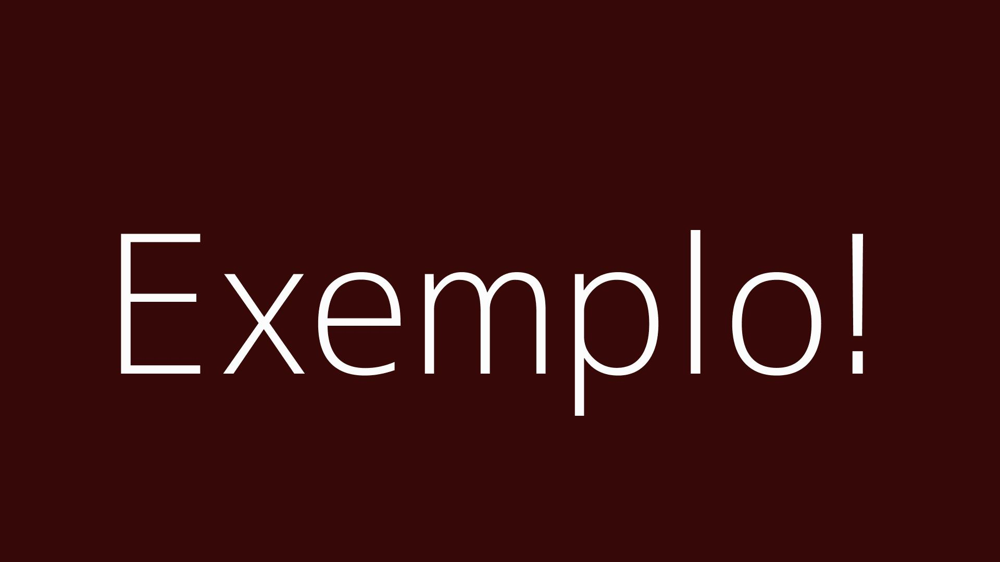

# Título


## Descrição:
- O que é?
- O que faz?
- Ferramentas utilizadas?
- Por que foi contruído?
- Badges

## Instruções de Instalação


### Pré-Requisitos:
- bla
- bla
- bla
### Etapas:
- bla
- bla
- bla

```
blocos de código
```

## Instruções de Uso:
```
blocos de código
```

1)  Passo 1
2) Passo 2
3) Passo 3

bla bla bla

## Licença

### Permissões (ReadOnly, Educacionar, Uso Profissional...)

## Contribuição
### Não dá pra você contribuir nesse aqui não...

## Contribuidores
### Time responsável
| Colaborador      | Função         | Perfil do GitHub                      |
|------------------|----------------|---------------------------------------|
| Bárbara Jeronimo |                |                                       |
| Beatriz Alvez    |                |                                       |
|    Bruno Riul    | InfraEstrutura | [ISKAI23](https://github.com/ISKAI23) |